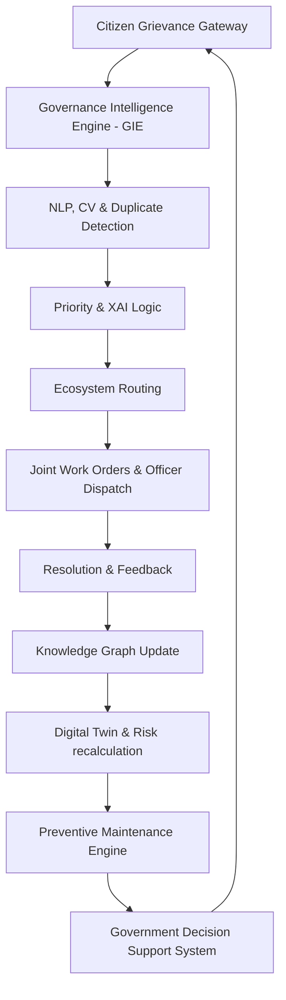

# CURE: City Unified Response & Evolution Platform
> **Slogan:** *"Smarter Decisions. Stronger Cities."*

---

## 1. Abstract
Urban centers globally struggle to manage civic infrastructure complaints efficiently. Conventional grievance redressal portals (such as MyGHMC or CPGRAMS) function as passive ticket-routing databases. They receive complaints, assign them to officers, and close them once repaired, ignoring the systemic failures that cause these issues to recur. 

**CURE (City Unified Response & Evolution Platform)** is an AI-powered Smart City Decision Support System (GDSS) that transitions municipal management from reactive complaint redressal to proactive, systems-oriented planning. Guided by Donella Meadows' principles of Systems Thinking, CURE models civic ecosystems by mapping the interdependencies between citizen reports, department workflows, weather metrics, budgets, and policies. Powered by the **Governance Intelligence Engine (GIE)**—a cooperative multi-agent AI system—CURE parses grievances in multiple languages, runs real-time Computer Vision audits, traces cascading failures through a Temporal Knowledge Graph, simulates policy adjustments, and generates self-healing preventive maintenance work orders. This platform demonstrates how cities can leverage data to eliminate grievances before they manifest.

---

## 2. Problem Statement & Existing System
Existing grievance systems (e.g. MyGHMC, CPGRAMS, standard ticketing portals) suffer from three structural flaws:
1. **Isolated Grievance Management**: Each complaint is treated as an isolated ticket. If a pipe burst degrades a road asphalt layer, the Water Department and Road Department operate in silos, leading to overlapping repairs, resource waste, and repeat complaints.
2. **Reactive Operations**: Portals rely entirely on citizen reporting. There is no automated warning system to inspect sewers before monsoon rainfall peaks or check streetlights before their mean time to failure (MTTF) is reached.
3. **No Root Cause Analytics**: Systems fail to capture *why* issues repeat. Ward 45 may receive 400 road patch complaints, but the system never highlights that poor drainage design is waterlogging the asphalt, making temporary road patching futile.

---

## 3. Proposed System (The CURE Solution)
CURE introduces a systems-level architecture bridging the Citizen Gate and the Government Decision Support System (GDSS):
- **Continuous Learning Loop**: Feedback from resolved tasks updates the AI's durability coefficients, improving future scheduling accuracy.
- **Explainable Decision Making**: All prioritizations display confidence levels and causal triggers (e.g., proximity to hospitals, traffic loads).
- **Interactive Single-Ward Digital Twin**: Models Ward 45's parameters (road health, drainage, streetlights, budgets, rainfall) to visualize risk thresholds in real-time.
- **Temporal Knowledge Graph**: Connects complaints to budgets, rainfall, road age, and officer logs. Hovering over a node displays the cascading paths of structural degradation.

---

## 4. System Objectives & Scope
- **Objective 1**: Reduce recurring civic complaints by 30% through predictive desilting and streetlight check schedules.
- **Objective 2**: Reduce public office visits by 60% by automating timeline tracking and providing root-cause delay explanations.
- **Objective 3**: Optimize municipal budgets by highlighting where joint department tasks (Roads + Water Board) avoid overlapping repair costs.
- **Objective 4**: Ensure spatial equity and transparency via the AI-monitored Ethics and Digital Constitution engine.

---

## 5. Governance Intelligence Engine (GIE) AI Architecture
GIE acts as the central coordinator, orchestrating 8 cooperative agents:
1. **Citizen Assistant**: Navigates user status queries and delay explanations.
2. **Complaint Intelligence Agent**: Runs NLP parsing and maps semantic texts to categories.
3. **Infrastructure Analyzer**: Tracks road wear, drainage silting, and grid MTTF values.
4. **Disaster Predictor**: Correlates weather data (rainfall) with drainage blockage indices to forecast floods.
5. **Resource Optimizer**: Dispatches engineers, vacuum jetters, and traffic police.
6. **Budget Planner**: Reallocates funds from reactive maintenance to preventive structures.
7. **Explainable AI (XAI) Agent**: Audits GIE decisions to output confidence levels.
8. **Policy Advisor**: Evaluates simulated municipal intervals to propose schedule updates.

---

## 6. Database & Ward Telemetry Parameters
The ward is modeled as an integrated object state containing:
- **Telemetry Indicators**: Real-time rainfall (mm), maintenance frequency (days), traffic density, and census population.
- **DNA Indicators**: Road Network Health %, Drainage Flow Index %, Streetlight Efficiency %, and Waste Collection Freq %.
- **Resilience Scorecard**: Resilience Index %, Recovery Speed %, Adaptability %, and Citizen Participation Score.

---

## 7. Algorithms & Simulation Logic
### 7.1. Risk Recalculation Algorithm
$$\text{Road Health (t)} = \text{Base Health} - (\text{Rainfall} \times 0.18) - (\text{Maint Interval} \times 0.08)$$
$$\text{Drainage Flow (t)} = \text{Base Flow} - (\text{Rainfall} \times 0.35) - (\text{Maint Interval} \times 0.06)$$
$$\text{Resilience Index} = \frac{\text{Road Health} + \text{Drain Health} + \text{Recovery Speed} + \text{Adaptability}}{4}$$

### 7.2. Sentiment Auto-Reopen Logic
If citizen feedback sentiment is negative (e.g. "Work not completed" or "road failed again"):
1. Reopen Complaint State to `Escalated`.
2. Upgrade Priority to `Critical`.
3. Auto-route to Zonal Commissioner.
4. Update Graph node: `Citizen Trust` -15%, `Jubilee Budget` -10%.

---

## 8. Future Scope & Scalability
CURE's architecture is built modularly. Future expansions can include:
- **Climate Resilient Infrastructure Planning**: Integrating IoT moisture sensors inside asphalt roads.
- **Smart Grid Integration**: Direct telemetry inputs from electrical sub-stations for automated power outage scheduling.
- **Eco-Resilience Modules**: Tracking water pollution indexes and AQI parameters to deploy air purifiers and schedule green belt planting.
