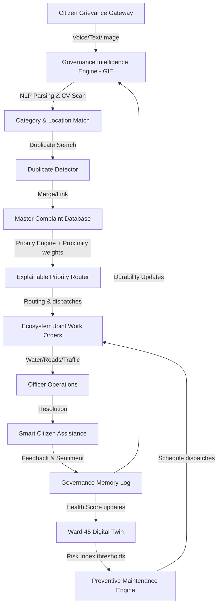
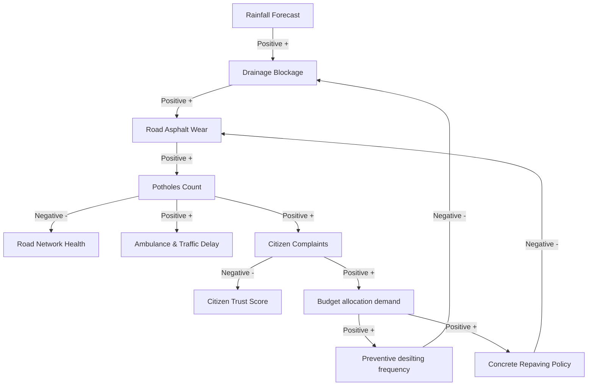
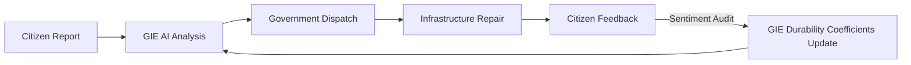
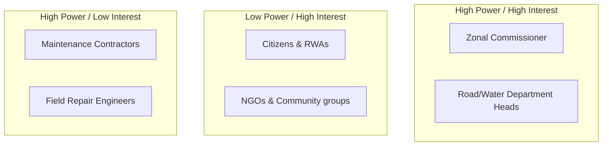

# Systems Diagrams Guide - CURE Platform
> **Slogan:** *"Smarter Decisions. Stronger Cities."*

These diagrams use Mermaid syntax, which you can render directly in Markdown viewers, Mermaid Live Editor, or copy-paste into your PowerPoint presentations.

---

## 1. System Architecture Diagram
Illustrates how data flows from the citizen, through the GIE brain, to the GDSS, and back to the infrastructure.



---

## 2. Causal Loop Diagram (CLD)
Traces the systemic reinforcing ($R$) and balancing ($B$) loops within CURE.



---

## 3. Feedback Loop Diagram
Shows the continuous learning loop, highlighting the feedback path from citizens to GIE AI learning coefficients.



---

## 4. Stakeholder Map
Categorizes stakeholders based on power and interest.



---

## 5. System Boundary Diagram
Defines what resides inside the CURE operating system vs what are external environment inputs.

```mermaid
rect rgba(0, 229, 255, 0.05)
    subgraph Inside CURE Boundary
        GIE[Governance Intelligence Engine]
        GDSS[Decision Support System]
        Twin[Ward 45 Digital Twin]
        Graph[Knowledge Graph]
        Rules[Digital Constitution rules]
    end
end
subgraph External Environment
    Weather[Rainfall / Climate API]
    CPGRAMS[State Databases]
    Public[Citizen Complaints]
    Finance[State Budget caps]
end
Weather -.-> GIE
CPGRAMS -.-> GIE
Public -.-> GIE
Finance -.-> GDSS
```
