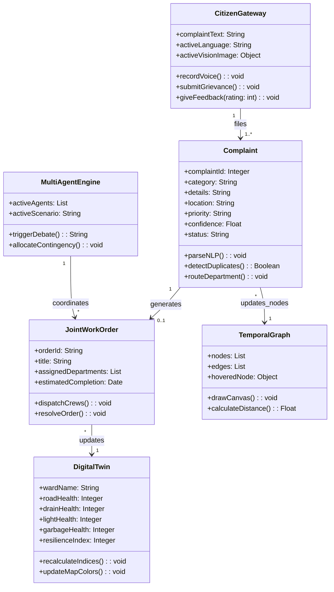
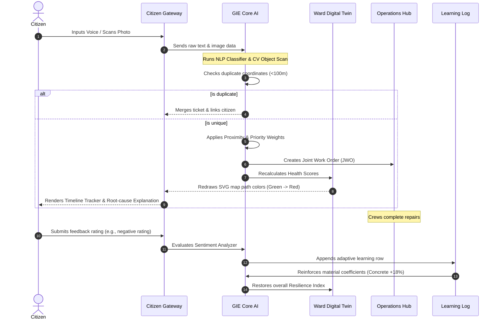
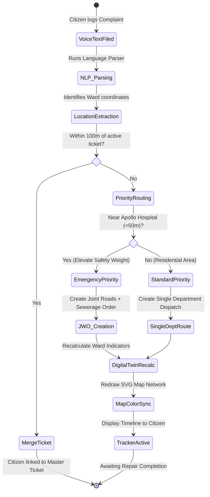
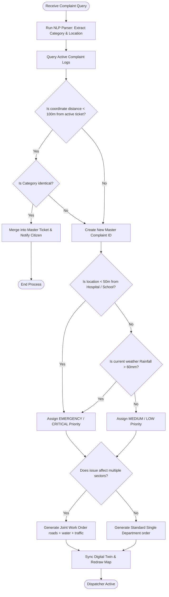

# UML & Flowchart Specifications - CURE Platform
> **Slogan:** *"Smarter Decisions. Stronger Cities."*  

This document provides copy-pasteable Mermaid diagrams representing the structural and behavioral UML models of the CURE platform. Copy these directly into Markdown viewers or PowerPoint slides.

---

## 1. Use Case Diagram
Models user roles (Actors) and their interactions with the platform's features.

```mermaid
usecaseDiagram
    actor Citizen
    actor GIE_Brain as Governance Intelligence Engine (AI)
    actor Commissioner as Zonal Commissioner
    actor Engineer as Field Engineer

    rectangle CURE_System {
        usecase UC1 as "File Multi-lingual Grievance"
        usecase UC2 as "Scan Photo via Computer Vision"
        usecase UC3 as "Track Timeline & Delay Explanation"
        usecase UC4 as "Recalculate Ward Health Indices"
        usecase UC5 as "Simulate Complex Scenarios"
        usecase UC6 as "Audit Budgets (Ethics Engine)"
        usecase UC7 as "Complete Joint Work Order (JWO)"
        usecase UC8 as "Submit Repair Feedback (AI Learning)"
    }

    Citizen --> UC1
    Citizen --> UC2
    Citizen --> UC3
    Citizen --> UC8

    GIE_Brain --> UC1
    GIE_Brain --> UC2
    GIE_Brain --> UC4
    GIE_Brain --> UC6

    Commissioner --> UC4
    Commissioner --> UC5
    Commissioner --> UC6

    Engineer --> UC7
```

---

## 2. Class Diagram
Represents the structural static classes, attribute data types, and method signatures inside CURE.



---

## 3. Sequence Diagram (Grievance to Learning Loop)
Models the dynamic step-by-step interactions and message passing between components.



---

## 4. Activity Diagram
Represents the procedural workflow of CURE's internal GIE engine when a citizen logs a ticket.



---

## 5. Flowchart: Duplicate Search & Routing Logic
Details the programmatic conditional logic checks executed by GIE.


